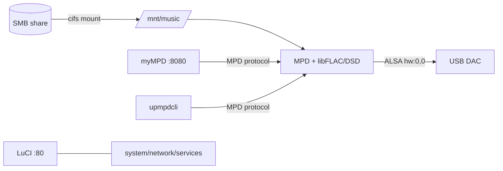

# Workflow — Building a Purpose-Built OpenWrt Music Streamer

How this project was approached end to end: requirements, platform validation,
architecture decisions, the build/debug loop, verification, and publication.
Written as a reusable playbook rather than a changelog.

---

## 1. Requirements capture

The request was deceptively simple: reuse an ASUS RT-AC88U as a music streamer
for a USB DAC, with no routing, as light as possible, controlled from a phone,
library on a network SMB share.

| Requirement | Decision |
|---|---|
| No routing / firewall / DHCP server | Strip the router stack, keep `netifd` + DHCP client |
| Lightest possible | `mpd-mini`, no LuCI initially, no Wi-Fi stack |
| USB DAC (Topping DX5 II) | `kmod-usb-audio`, ALSA `hw:0,0` |
| Phone control | myMPD web UI + UPnP renderer (+ M.A.L.P. option) |
| Music on SMB share | `kmod-fs-cifs` + `cifsmount`, mounted at `/mnt/music` |
| High-res / DSD | Custom MPD build with `-Ddsd=true`, DoP output |
| Web management | LuCI (module-level, without firewall/PPP apps) |

## 2. Platform validation before building

Checks done first, because they invalidate whole designs:

- **Device support:** RT-AC88U is a `bcm53xx` target; image present in 24.10.8.
- **Wi-Fi:** BCM4366 has no usable OpenWrt AP driver → design must be wired-only.
- **USB:** both ports are host controllers → DAC can attach.
- **Storage:** 128 MB NAND → ~109 MB overlay, ample for packages.
- **DAC:** Topping DX5 II is UAC2 class-compliant and self-powered → kernel
  `snd-usb-audio` works without vendor drivers; enumerates as card 0.

> Lesson: confirm the *unusable* parts (Wi-Fi) before promising a form factor.

## 3. Architecture

- **Player:** MPD, not LMS. LMS is Perl/heavy and not packaged; MPD is a single
  binary with direct ALSA output.
- **Variant:** `mpd-mini`, because `mpd-full` is built with PulseAudio support.
- **Control:** myMPD for browsing/queue; upmpdcli for UPnP/OpenHome clients.

## 4. Build strategy

Two mechanisms exist, and choosing the right one matters:

| Mechanism | Use for | Limitation |
|---|---|---|
| **Image Builder** | Package add/remove, overlay files | Cannot change build-time options (`CONFIG_*`) |
| **SDK / buildroot** | Rebuilding a package with different flags | Config system and dependency resolution are fragile |
| **Direct cross-build** (meson/cmake) | One binary with custom options | You manage dependencies and patches yourself |

The final image uses the Image Builder with a `FILES=` overlay containing the
custom `mpd`, `mympd` and first-boot scripts.

## 5. Iteration log

Six builds, five distinct configurations, each driven by a concrete finding:

| # | Build | Size | Change / why |
|---|---|---:|---|
| 1 | `mpd-full` | 17 MB | Baseline; rejected after dependency audit |
| 2 | `mpd-mini` | 11 MB | Removed PulseAudio/BlueZ/Avahi/D-Bus |
| 3 | + DSD `mpd` | 11 MB | Custom `-Ddsd=true` binary overlaid |
| 4 | RPATH cleanup | 11 MB | Stripped host path from the binary |
| 5 | DHCP LAN default | 11 MB | `uci-defaults` instead of static 192.168.1.1 |
| 6 | LuCI + myMPD + SMB | 14 MB | Final feature set |

### Key discovery during iteration 1

`mpd-full` depends on `+AUDIO_SUPPORT:pulseaudio`; the feed builds with that on,
which pulls `pulseaudio-daemon-avahi → dbus → avahi → bluez → glib2`. The
manifest audit exposed it — not the package name.

> Lesson: always read the resolved manifest, not the requested package list.

## 6. The hard part: rebuilding MPD with DSD

The SDK path fought back at every step. What actually happened:

1. **Config resets:** in SDK mode the catch-all make target runs
   `conf --defconfig` before every build, re-selecting the whole package
   universe (`CONFIG_ALL=y` is the default). Editing `Config.in` and explicit
   "is not set" lines did not reliably survive.
2. **Variant leakage:** building the `sound/mpd` directory compiles *both*
   `mpd-full` and `mpd-mini`, dragging in the PulseAudio chain even when only
   mini is selected.
3. **Decision point:** stop fighting the package system and cross-compile the
   binary directly with meson against the SDK staging libraries.

That produced three more traps, all fixed:

| Trap | Fix |
|---|---|
| Toolchain "C compiler cannot create executables" | export `STAGING_DIR` |
| `-Ddsd=false` upstream; fmt 11 compile error | flip flag; apply feed's fmt-11 patch |
| Patch `020-string-view` needs a boost header not shipped | revert it; use `std::string_view` |
| `-Dflac/-Did3tag` link failure (`libz.so.1` not found) | disable optional myMPD-side parsers |
| Meson auto-linked avahi/dbus/mms/soxr | disable explicitly (`-Dzeroconf=disabled`, …) |
| Binary had host RPATH | `patchelf --remove-rpath` |

## 7. myMPD

Not packaged for 24.10, so it was cross-compiled too:

- Built missing deps into staging: **OpenSSL 3.0.21** and **PCRE2 10.42**.
- cmake cross toolchain file + `-DMATH_LIB=<toolchain>/libm.a` (musl has no
  standalone libm.so for `find_library`).
- `MYMPD_EMBEDDED_LIBMPDCLIENT=OFF` so cmake detects the too-old staging
  libmpdclient and falls back to the bundled copy **with** its compile define.
- Removed `-Werror` for the vendored mongoose build on GCC 13.
- Assets embedded; Lua/utf8proc/id3tag/FLAC parsers disabled (MPD still supplies
  tags and artwork).

## 8. First-boot defaults

The image has no DHCP server, so access was the first usability problem.

- Option A: use the WAN port (DHCP client by default).
- Option B: make LAN a DHCP client too, via
  `/etc/uci-defaults/99-lan-dhcp`.

The script ordering matters: `config_generate` writes the board defaults first,
then `uci_apply_defaults` runs the scripts. Naming it `99-*` guarantees the
override wins, and it deletes itself after running.

## 9. SMB library

- Kernel side: `kmod-fs-cifs` (pulls NLS + crypto modules).
- User side: `cifsmount` provides `/usr/sbin/mount.cifs`.
- Mounted via `fstab` with `credentials=`, `vers=3.0`, `iocharset=utf8`, `ro`.
- MPD's `music_directory` is the mount point, so the library is independent of
  any local USB storage.

## 10. Verification protocol

Every artifact was checked before being handed over:

- SHA256 of each image, compared against the build's own `sha256sums`.
- TRX magic (`HDR0`) confirmed.
- `readelf -d` → every `NEEDED` library checked for presence in the image rootfs.
- Overlaid binary hash compared with the staged file.
- Release asset digest compared with the local image hash.

> Lesson: a green build is not evidence. Verify the bytes you ship.

## 11. Documentation and publication

- README carries flashing, SMB, UI and limitation notes.
- `docs/` holds build, hardware and troubleshooting detail; changelog tracks v1.0.
- Image published as a **release asset**, not committed to git.
- GitHub auth used the device flow; two attempts failed because `~/.config` is
  read-only in the sandbox, fixed with `GH_CONFIG_DIR` inside the workspace.
  Credentials were deleted afterwards.

## 12. What went wrong (and the general lesson)

| Mistake | Lesson |
|---|---|
| Trusted `mpd-full` as "just MPD" | Audit transitive dependencies before accepting size |
| Assumed Image Builder `-pkg` removals win | Dependency resolution can re-add/override |
| Fought the SDK config system for too long | Switch to direct cross-build once package tooling resists twice |
| Forgot `STAGING_DIR` | OpenWrt toolchains need it for sysroot resolution |
| Left RPATH in a cross-built binary | Always check `readelf -d` before shipping |
| Device had no DHCP server | Decide first-boot networking before flashing |
| Stored gh token in a read-only home | Point `GH_CONFIG_DIR` at a writable path, clean up after |

## 13. Reusable checklist

1. Validate platform support and the *unsupported* radios/ports first.
2. Choose the player by weight and packaging reality, not familiarity.
3. Build a baseline, then audit the manifest; remove, rebuild, re-audit.
4. When a package needs build-time flags the Image Builder cannot set, decide
   early between SDK rebuild and direct cross-compile.
5. Cross-compile with: `STAGING_DIR`, sysroot include/lib paths, a toolchain
   file, and explicit disabling of auto-detected libraries.
6. Strip RPATH; verify `NEEDED` against the target rootfs.
7. Handle first boot explicitly (`uci-defaults`), including network mode.
8. Verify hashes and TRX headers at every hand-off.
9. Publish the image as a release asset; keep the repo source/config only.
10. Document the traps while they are fresh — they are the most reusable output.

---

## 14. Collaboration analysis

An honest look at how the work was commissioned and steered: what information was
supplied, when, and whether it was specific enough.

### 14.1 What you supplied, and when

| Phase | Information provided | Kind | Sufficient? |
|---|---|---|---|
| Opening brief | RT-AC88U, Topping DX5 II, no routing, "lightest possible", MPD **or** LMS, phone control | Goal-level | Enough to start; **not** enough to build — library location, formats, UI, addressing and publication were all unspecified |
| Package list | Proposed include/exclude sets | Technical, but partly outdated | Useful signal of intent; contained errors (see 14.3) |
| Constraint decisions | "UPnP, not AirPlay"; "include local USB drive support" | Execution-grade | Yes — directly changed the package choice |
| Data | Music library path | Factual | **Decisive** — the 108 DSF/DFF files made DSD support mandatory |
| Approvals | "go with option 1", "yes", "no it's fine", "done" | Decision-level | Sufficient at each gate |
| Late context | "replacing a Lenovo SFF PC running Volumio", asks about WebUI/Android apps | Requirement discovery | Material, but arrived **after** a working image existed |
| Scope change | LuCI + myMPD, "all music on a separate PC shared via SMB", include SMB client packages | Execution-grade | Yes — the largest single change, also late |
| Publication | Repo name, exclude `.trx` from git, device-flow auth, make public, add topics/docs | Execution-grade | Yes |
| External facts | DeepSeek pricing URL, "generate as md" | Factual | Yes — enabled exact cost figures |
| Follow-up | Workflow report request | Goal-level | Yes |

### 14.2 Specificity scorecard

- **31** real user messages, **1,366** words total: median **35** words, p90 **90**, max 155.
- Roughly **5** messages were execution-grade (a concrete constraint or action).
  The rest were goals, questions, approvals, or context.
- **Never specified** (and correctly delegated): package versions, patches,
  build system, dependency handling, verification method, file layout.
- **Not supplied early**: library location/protocol, required formats (DSD),
  WebUI expectation, first-boot addressing, publication target.

### 14.3 Where imprecision cost time

| Late constraint | Consequence | Avoidable? |
|---|---|---|
| Library was on SMB, not local USB | Reworked package set and mount design; extra image build | Yes — one question |
| DSD requirement (108 files) | Extra cross-build + rebuild for `-Ddsd=true` | Yes — "which formats?" |
| Web UI expected (Volumio replacement) | myMPD cross-compile (~45 min) + image rebuild | Yes — "what UI?" |
| Publication requirements | No rework; done at the end | — |

Estimated **30–60 minutes** of the 2 h 44 m was attributable to these late
constraints. Most of the elapsed time went to genuine engineering: the SDK
config fight, the manual cross-builds, and verification — not to requirement churn.

### 14.4 Division of labour

| You | Me |
|---|---|
| Product goals and constraints | Platform research and support validation |
| "Lightest possible", "no routing" | Dependency audits and package selection |
| Protocol choices (UPnP, not AirPlay) | Build engineering and debugging |
| Factual inputs (library path, pricing) | Cross-compilation, patching, linking |
| Approvals and course corrections | Verification and release packaging |
| Publication decisions | Documentation |

### 14.5 Verdict

This was not "vague details plus heavy lifting" in the pejorative sense. It was a
**goal-level brief with late-binding constraints** — a normal way to commission
exploratory work, but one that front-loads uncertainty. The opening brief was
sufficient to *start* and insufficient to *converge in one pass*; the design was
allowed to discover its own requirements, which cost a few rebuilds.

What you did supply precisely was high-leverage: "UPnP, not AirPlay", "SMB on a
separate PC", "no `.trx` in git", "remove the token". Each of those either changed
the architecture or prevented a real problem. The technical package list was the
one piece of *specific* input that was partly wrong — which is expected, since
OpenWrt's packaging details change faster than general knowledge.

The delegation itself was reasonable: you cannot be expected to specify meson
flags or patch series. The gap was not depth, it was **sequence** — a handful of
product questions answered up front would have collapsed two or three iterations.

### 14.6 A brief that would have converged faster

1. Where is the library — USB, SMB, or NFS — and what path/credentials?
2. Which formats must play, including DSD and its maximum rate?
3. What control surfaces are required — web UI, UPnP, native phone apps?
4. Fixed IP or DHCP; which device serves DHCP?
5. Management by SSH only, or a web admin UI?
6. Publish where, at what visibility, with the image as a release asset?
7. What are the acceptance tests — bit-perfect, DSD, concurrent clients, phone control?

Answering 1–3 before the first build would have removed most of the rework;
4–7 only affected the final packaging stage.

---

## 15. Hardware bring-up

The image flashed cleanly and the DAC enumerated on first boot, but playback
still failed. Two independent causes had to be separated:

- **USB link instability.** `dmesg` showed `error -71`, repeated disconnect /
  re-enumeration and "attempt power cycle". This is a physical-layer symptom
  (cable/port), not an ALSA or MPD configuration problem. After moving to a
  stable port/cable, the disconnect count stayed at **0** for the rest of the
  session.
- **Group permissions.** `/dev/snd/pcmC0D0p` is `root:audio 660`, and `mpd` was
  not in `audio`. ALSA/MPD surfaced this as *"No such file or directory"* on
  `hw:0,0`, which reads like a missing device but was a permission denial.
  Checking `id mpd` and `ls -l /dev/snd` is faster than chasing the device string.

The lesson: when a USB audio device "disappears", check the kernel log first,
then device-node ownership, then the player configuration — in that order.

## 16. Persistence and boot ordering

Three separate tmpfs losses looked like one "settings don't stick" bug:

1. MPD database/state under `/var/lib/mpd` → moved to `/etc/mpd`.
2. myMPD workdir under `/var/lib/mympd` → moved to `/etc/mympd`.
3. The SMB mount itself: UCI `fstab` entries are not mounted by `block mount`
   for network shares, so a static `/etc/fstab` line was required.

Two ordering traps compounded it:

- `fstab` runs before DHCP, so the first mount attempt fails; a retry is needed
  after the interface is up.
- The retry checked `[ -d /mnt/music ]`, which is true even when nothing is
  mounted. Checking `/proc/mounts` is the correct test.

A third, subtler issue: the `mympd` user was created with uid 89, colliding with
`upmpdcli`. It worked, but file/process ownership was misleading; uid 91 fixed it.

## 17. Optimisation pass

The appliance was already lean — **1.2 MB of 96 MB overlay**, 32 MB RAM used,
~6 % CPU — so debloating was about correctness and noise, not resources.

Applied:

- disabled `packet_steering` (failed at every boot), `cron` (no jobs),
  `gpio_switch` (no config)
- myMPD `loglevel` 5→3; MPD `log_level "error"`
- CIFS `actimeo=1`→`60`

Deliberately **not** removed: `block-mount`/`fstools` (fstab init), `libiwinfo`/
`rpcd-mod-iwinfo` (LuCI dependencies), OSS/MIDI ALSA modules (dependency risk).
The USB-storage stack (~1.9 MB) is only worth removing if USB drives will never
be used — a requirement question, not a technical one.

## 18. Benchmarking methodology

To keep numbers comparable across routers, the benchmark is a **self-contained
static binary** (`bench/bench.c`) rather than an opkg-installed tool. That avoids
version drift, network dependencies and missing packages on other devices.

Pitfalls encountered:

- The compiler removed a benchmarked `memcpy` (absurd TB/s result); keeping the
  destination alive with a checksum fixed it.
- On Cortex-A9, sequential **read** bandwidth is far below **write** bandwidth
  (no hardware prefetcher, limited outstanding loads). That is a property of the
  core, not a bug; `memcpy` tracks the read figure, which corroborates it.
- tmpfs numbers measure RAM, not storage; UBIFS numbers include NAND/ECC and are
  size-sensitive.
- CIFS read throughput reflects the server and network, not the router CPU.
- Single runs; treat <5 % differences as noise.

Publishing the source, build flags and raw output matters more than the numbers
themselves.

## 19. Publication and repository hygiene

- The image is a **release asset**, not a git blob; the repo stays source/config.
- Manual web-UI uploads diverged the history twice. Resolution: fetch, then merge
  keeping canonical files (`-X ours`) while accepting genuinely new uploads.
  Verify with the API (HEAD SHA, raw-file greps) rather than trusting the push.
- `gh` device-flow auth needs a writable config directory (`GH_CONFIG_DIR`),
  because `~/.config` is read-only in this sandbox. The OAuth token is stored in
  plain text there and was deleted after every push.

## 20. Collaboration during bring-up

The working style shifted from specification to diagnosis: the user supplied
concrete evidence — error banners, `dmesg`, `aplay -l`, `ip addr`, `logread` — and
the agent turned symptoms into root causes. That is the efficient shape for
hardware bring-up: the person at the device observes, the agent analyses and
proposes the next probe.

No new product requirements appeared after the build; what looked like scope
change (phone app, HTTPS, persistence) was defect discovery. The earlier
collaboration assessment still holds: the brief was goal-level, the late
requirement that actually cost time was the SMB library, and fixes were cheap
once the evidence arrived.

---

*Companion documents: `README.md`, `BENCHMARKS.md`, `docs/BUILD.md`,
`docs/HARDWARE.md`, `docs/TROUBLESHOOTING.md`, `PROJECT-REPORT.md`
(token/cost metrics).*
