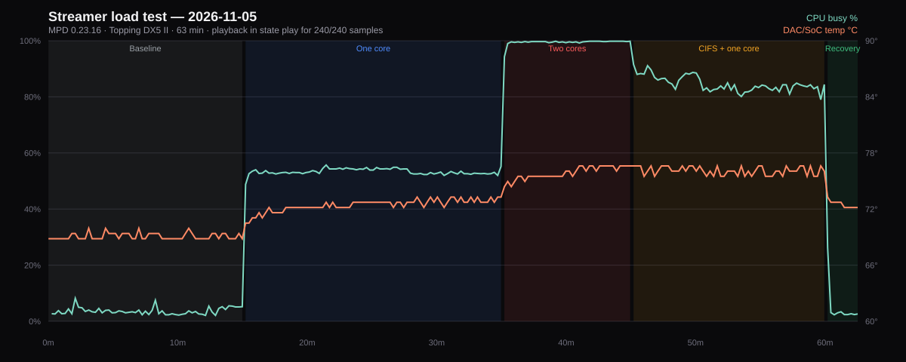

# Streamer load/stability test — 2026-11-05

**Device:** ASUS RT-AC88U · OpenWrt 25.12.6 · MPD 0.23.16 (DSD-enabled)  
**DAC:** Topping DX5 II over USB (`hw:0,0`, native DSD)  
**Test window:** 2026-11-05 16:20–17:22 AWST (host clock; the streamer's own clock was ~2 days behind)  
**Samples:** 240 at 15 s intervals · **Duration:** 62.5 min  
**Queue:** the full collection, shuffle enabled (`random: 1`)

## Verdict

**Playback was never interrupted and never stalled.** All 240 samples show MPD in `play`; there were **240/240** playing samples, **0** pauses/stops, **0** MPD errors, **0** stall events, **0** USB/CIFS errors and **0** ALSA xruns/underruns. The DAC stayed in `Status: Running` throughout, including during both cores at ~100 % and a 2 GB CIFS read.

- Track changes: **16**, all clean transitions via shuffle — the only silences are the intended gaps between tracks and the DAC re-locking to a new rate, not transport stutters.
- Peak temperature: **76.6 °C**; memory available never below **311 MB** of 497 MB; peak load **4.27**.
- CPU peaked at **99.8 %**; MPD itself never needed more than a few percent.

## Method

The queue played through MPD while load was applied in phases:

| Phase | Duration | Applied load |
|---|---|---|
| Baseline | 15 min | none |
| One core | 20 min | one `yes` busy loop (one of two Cortex-A9 cores saturated) |
| Two cores | 10 min | two `yes` loops (both cores saturated) |
| CIFS + one core | 15 min | a 2 GB `dd` read of the DSD512 file over SMB, plus one `yes` |
| Recovery | 2 min | load removed; playback monitored |

Every 15 s the monitor recorded MPD `status`/`currentsong`, ALSA `hw_params` and `stream0`, USB state, CPU busy and MPD CPU from `/proc`, load, `free`, thermal zone, and `dmesg`/`logread` error counts. The queue was never modified. The run was stopped at the listener's request after the CIFS phase, so the recovery window is short.

## Phase results

| Phase | Samples | CPU avg / max | MPD avg / max | Load | Temp avg / max | Mem avail min | Stalls | States |
|---|---|---|---|---|---|---|---|---|
| Baseline | 59 | 3.6 / 8.2 % | 2.4 / 4.0 % | 0.16 | 69.1 / 69.9 °C | 347 MB | 0 | play:59 |
| One core | 77 | 53.3 / 55.7 % | 1.8 / 4.3 % | 1.15 | 72.4 / 73.3 °C | 349 MB | 0 | play:77 |
| Two cores | 38 | 99.5 / 99.8 % | 3.0 / 3.9 % | 2.17 | 75.9 / 76.6 °C | 350 MB | 0 | play:38 |
| CIFS + one core | 56 | 84.6 / 91.5 % | 3.6 / 14.3 % | 3.52 | 76.1 / 76.6 °C | 311 MB | 0 | play:56 |
| Recovery | 10 | 5.0 / 26.2 % | 1.6 / 2.4 % | 1.23 | 72.5 / 73.3 °C | 348 MB | 0 | play:10 |

## Playback continuity

- **MPD state:** play 240; no `pause`, `stop` or reconnect sample.
- **MPD errors:** 0; **stall events:** 0 (definition: a playing sample whose `elapsed` advanced by less than 40 % of the wall time over 5+ s, excluding track changes).
- **USB / CIFS / xrun counters:** `dmesg` 0, `logread` 0 (cumulative error-pattern matches at the end). **DAC:** Running 240.
- **Track transitions:** 16 changes; 1 state event (the initial `'' -> play` only).
- **Audio formats seen:** `44100:16:2` × 127, `96000:24:2` × 43, `48000:24:2` × 36, `44100:24:2` × 34; **ALSA:** `S32_LE` @ 44100 Hz × 161, `S32_LE` @ 96000 Hz × 43, `S32_LE` @ 48000 Hz × 36.

The streamer fed the DAC continuously; the CIFS read of the DSD512 test track ran alongside the queue without producing any USB or SMB error. The normal track-change gap and the DAC's rate re-lock are the only discontinuities, and they are expected.

## Caveats

- The run was stopped at the listener's request at ~62 min; the recovery window is ~2 min, not the planned 10.
- The streamer's clock is ~2 days behind; all timestamps above are host time. MPD's own log timestamps share that offset.
- Sampling is every 15 s; a sub-15 s glitch that left no `elapsed`/state/error trace could be missed, though no USB/CIFS/xrun counters moved.
- This run's queue was PCM FLAC; the DSD512 native path was verified separately (the CIFS phase read the DSD512 file, but the queue did not play DSD during the load test).
- No memory-pressure or flash-write stress was applied; the load was CPU and CIFS read, with no writes to the overlay.

## Raw data

- `stress.csv` — 240 rows, the full sample series
- `events.log` — track changes, state changes, stalls, error-counter changes
- The test monitor and remote load script are in the same `.stress/` directory
